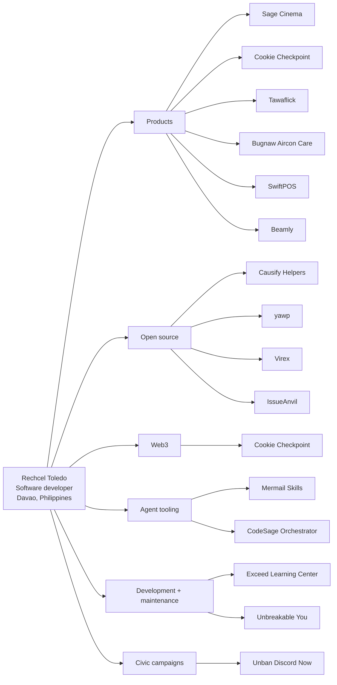

# Rechcel Toledo — Software Developer, phcodesage

Hi, I’m Rechcel Toledo. I run phcodesage, a one-person product studio based in Davao, Philippines, and I still ship the code. I build thoughtful digital products across frontend, backend, open source, on-chain applications, and agent tooling.

I enjoy turning rough ideas into clear, useful experiences—from polished interfaces and API-driven products to developer tools and blockchain experiments. I care about good product decisions, maintainable code, and the small details that make software feel considered.

## Live site

Visit the live portfolio at [phcodesage.github.io](https://phcodesage.github.io/).

You can also [view the resume](https://phcodesage.github.io/resume.html) or browse the [case studies](https://phcodesage.github.io/#work).

The About section uses the optimized `assets/rechcel-portrait.webp` portrait, with a cat favicon at `assets/cat-mark.svg`. Original PNG assets remain available.

The personal gallery in About contains nine photos in `assets/about/`. Full-size WebP files preserve each supplied photo’s original dimensions at quality 90; photos wider than 640 pixels also have quality-85 previews for responsive loading. Select a photo to view it at full resolution, use the arrow keys or Previous/Next controls to browse, and press Escape to close. With JavaScript disabled, the gallery links open the WebP files directly.

## Portfolio

- [Clara Health](https://phcodesage.github.io/case-studies/clara-health.html) — a healthcare portfolio prototype with contextual sample conversations, browser voice, doctor discovery, sample booking, records, and provider draft review. DeepSeek is prepared for a later phase; the public demo uses scripted responses and fictional data. [Live demo](https://clara-health.pages.dev/).
- [Tawaflick](https://phcodesage.github.io/case-studies/tawaflick.html) — a curated Philippine meme library with browser-local GIF and short-video conversion, owner-only uploads, search, and shareable downloads. [Live site](https://tawaflick.pages.dev/).
- [Bugnaw Aircon Care](https://bugnaw.lovable.app/) — a Metro Cebu aircon care booking experience with multilingual messaging, available slots, and reminders.
- [Unban Discord Now](https://unban-discord-now.pages.dev/) — a public campaign collecting Filipino workers’ stories and reports about Discord access disruptions.
- [Cookie Checkpoint](https://phcodesage.github.io/case-studies/cookie-checkpoint.html) — an open-source on-chain streak app for Cookie Chain. The hosted demo is currently unavailable; the case study links to its source and local setup instructions.
- [Sage Cinema](https://sage-cinema-nu.vercel.app/) — a TMDB-powered movie discovery experience with search, recommendations, and watch history.
- [Mermail Skills](https://github.com/phcodesage/mermail-skills) — portable agent workflows for email, scheduling, support, and GTM automation.
- [Causify Helpers contribution](https://github.com/causify-ai/helpers/pull/1396) — a Python AST-based private-function linter with tests and actionable diagnostics.

## Also in the portfolio

- [Jinjalume](https://phcodesage.github.io/jinjalume/) — open-source Tailwind UI components for Flask, Jinja, and Python web apps.
- [yawp](https://github.com/phcodesage/yawp) — a private, fully local macOS dictation tool built in Swift.
- [IssueAnvil](https://github.com/phcodesage/issueanvil) — a deterministic Rust CLI and GitHub Action for project housekeeping.
- [SwiftPOS](https://github.com/phcodesage/Swift-Pos) — a browser-based point-of-sale system for small Philippine stores.
- [SageMovies TUI](https://github.com/phcodesage/sagemovies-tui) — a keyboard-first Rust terminal interface for movies and series.
- [Virex](https://github.com/phcodesage/Virex) — a native macOS writing assistant built with Rust, Tauri, and SolidJS.
- [Beamly](https://github.com/phcodesage/beamly) — an end-to-end encrypted peer-to-peer file transfer app.
- [CodeSage Orchestrator](https://github.com/phcodesage/codesage-orchestrator) — a multi-agent Codex workflow with bounded roles and verification.
- [RemoteX](https://github.com/phcodesage/remoteX) — an attended remote-support foundation using Python, FastAPI, PySide6, and WebRTC.
- [Sage Movies source](https://github.com/phcodesage/sage_movies) — the open-source movie platform behind Sage Cinema.

## Clients & stewardship

- [Unconventional Psychotherapy](https://unconventionalpsychotherapy.com/about/) — psychotherapy practice platform.
- [Tri-State Coach Bus](https://tristatecoachbus.net/) — coach and group transportation platform.
- [Exceed Learning Center](https://www.exceedlearningcenterny.com/) — education, tutoring, enrichment, and test-prep platform. I’m the developer and maintainer.
- [Unbreakable You](https://unbreakable-you.com/) — healing and empowerment coaching platform. I’m the developer and maintainer.
- [Swim Studs](https://swimstuds.com/) — professional pool cleaning, maintenance, and repair services.
- [Ventured](https://www.venturedbrands.com/) — brand accelerator and consumer-brand portfolio platform.

## Work history

The experience section on the site is based on the public history in [portfolioV2](https://github.com/phcodesage/portfolioV2):

- **Onlinejobs.ph** (Aug 2023 — Present) — Software Developer, building real-time communication systems with Flask, WebRTC, and WebSockets.
- **Udemy** (Jun — Aug 2023) — Web Development Instructor, creating practical front-end and back-end courses.
- **Purple Roof** (March — May 2023) — Junior Frontend Developer, contributing to mortgage platform features.
- **Rooche Digital** (Dec 2022 — Mar 2023) — Backend Python Developer, developing and maintaining ecommerce APIs.

## Practice

- Frontend: React, Next.js, responsive interfaces, interaction design
- Backend: APIs, data flows, integrations, testing, maintainability
- Web3: Solana-compatible applications, wallets, RPC, on-chain UX
- Agent tooling: MCP servers, portable skills, and workflow automation

## Work graph



## GitHub activity


## Office

- Email: [rechceltoledo@gmail.com](mailto:rechceltoledo@gmail.com)
- WhatsApp: [Message me](https://wa.me/639703224930)
- Telegram bot: [@phcodesage-portfolio](https://t.me/phcodesage-portfolio)
- GitHub: [@phcodesage](https://github.com/phcodesage)
- Instagram: [@phcodesage](https://www.instagram.com/phcodesage/)
- Threads: [@phcodesage](https://www.threads.com/@phcodesage)
- X: [@phcodesage](https://x.com/phcodesage)

## Local development

This is a static site. The homepage and case studies use hand-written CSS. The Jinjalume component gallery uses committed Tailwind CSS, so GitHub Pages does not need a build service.

```bash
npm ci
npm run build
python3 -m http.server 8765
```

Open `http://localhost:8765`. Homepage edits need no build. After changing utility classes in the Jinjalume gallery, run `npm run build` and commit the generated CSS. Hand-written styles live in `styles/site.css`, `jinjalume/site.css`, and `case-studies/styles.css`; the hero garden lives in `garden.js`.

Project screenshots are stored locally in `assets/projects/`; capture sources are documented there. The contact form collects a reply number or username when WhatsApp or Telegram is selected. With JavaScript disabled, it submits through FormSubmit’s standard form endpoint using email as the reply channel.

## Visual design

The homepage is an anime-style Japanese garden. The hero is a live Three.js scene in `garden.js`, cel-shaded with ink outlines: a vermilion torii gate, three mossy stones in raked sand, and red, orange, and gold maple leaves (momiji) that drift down and leave ripples where they land. Moving a pointer across the sand, or tapping it on a phone, rakes new ripples. Behind it is an anime sky with drifting clouds by day, and stars and a moon by night. The sand grooves, moss, and shadows are drawn per pixel on a single plane, the scene pauses when it scrolls out of view or the tab is hidden, and reduced-motion visitors get a still, fully raked garden. Without WebGL or JavaScript, a CSS drawing of rings around a stone takes its place. Three.js 0.170.0 loads as an ES module from jsDelivr. Once the hero scrolls away, a few maple leaves keep drifting behind the page content.

Below the garden, the voyage (`voyage.js`) is a pinned, scroll-driven 3D scene in the style of Apple's product pages. As you scroll through it, a small wooden boat with a battened sail bearing the studio cat sails through a floating torii toward Mount Fuji, and the camera circles it through a sequence of shots. Four captions fade in and out along the way, the numbered chapter buttons jump to each part, and tapping the water sends rings across it. By day the sun sinks toward dusk as the voyage ends; at night a lantern lights the boat. With reduced motion or without JavaScript, the voyage becomes a static set of caption cards over the scene. The garden and the voyage share their tone ramp, ink outlines, torii, and leaf shape through `scene-kit.js`.

Every other section responds to scrolling as well (`script.js` sets `--enter`, `--p`, and `--exit` on each `[data-scroll]` element, and the CSS turns those into motion): project cards tilt up out of the page and lean toward the pointer, kanji seals stamp in while their dashed ring turns and a star orbits them, company tiles swing open like doors, the About text lights up word by word, skill tags and gallery photos fly in, the contact panel tips forward as its moon rises and its waves roll, and the footer seal spins into place. All of it is skipped for visitors who prefer reduced motion.

The palette is indigo ink, torii crimson, gold, steel, sky blue, and jade, with a vermilion hanko seal carrying the studio cat. Headings use Shippori Mincho B1 and body text uses Zen Maru Gothic. The interface borrows from anime and manga: inked outlines with hard offset shadows, a speech-bubble greeting, a vertical nobori banner with the name in katakana, bilingual navigation, and seigaiha wave patterns on the contact panel and footer. Each section is named by a kanji in the left margin, with its reading and meaning: 作 (to make) for works, 守 (to look after) for client work, 縁 (the ties between people) for companies, 人 (a person) for About, 試 (to try) for experiments, and 文 (a letter) for contact. The light/dark toggle follows the system setting until a visitor chooses. Case studies share the palette and type in `case-studies/styles.css`.

The companies and affiliations section contains the original nine organizations, with logos stored locally in `assets/` and `assets/companies/`. The gallery, experience, experiments, and contact form use native expandable sections. Navigation and expandable content remain usable without JavaScript.

## Traffic analytics

The private [analytics dashboard](https://phcodesage.github.io/analytics/) reports countries, project cards and demo/source clicks, page views, traffic sources, devices, and contact actions. Today, 7-day, and 30-day filters use Manila time. Detailed statistics require an owner password; the public page-view total preserves the earlier archive.

The collector stores no IP addresses, precise locations, full referrer URLs, search queries, or form contents. It honors browser privacy signals and the [traffic opt-out](https://phcodesage.github.io/privacy/). See [analytics/README.md](analytics/README.md) for architecture, access, deployment, and checks. Navigation and project cards now use consistent rounded SVG arrows.
